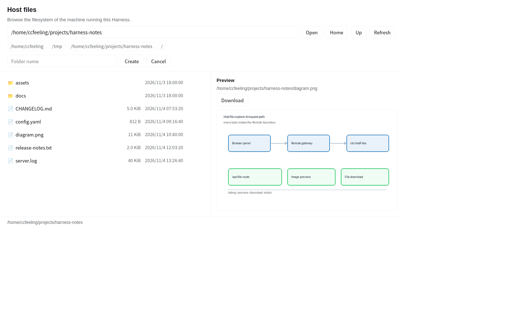

<div align="center">

[English](README.md) · [简体中文](README_zh.md) · [繁體中文](README_zh-TW.md) · [日本語](README_ja.md) · [한국어](README_ko.md) · [Türkçe](README_tr.md) · [Русский](README_ru.md) · [Tiếng Việt](README_vi.md) · [ไทย](README_th.md) · [Deutsch](README_de.md) · [Español](README_es.md) · [Français](README_fr.md) · [Українська](README_uk.md) · **Polski** · [Português (Brasil)](README_pt-BR.md) · [العربية](README_ar.md) · [فارسی](README_fa.md) · [Bahasa Indonesia](README_id.md) · [Italiano](README_it.md)

# Eksplorer plików DSH Host

### Plugin DeepSeek Harness, który dodaje wpis na lewym pasku bocznym umożliwiający przeglądanie systemu plików maszyny, na której działa Harness.

[](LICENSE)
[](#funkcje)
[](#architektura)

</div>

---

Przeglądaj system plików maszyny Host z wnętrza Harness: listy katalogów z rodzajami, rozmiarami i czasami modyfikacji, podgląd plików tekstowych oraz tworzenie folderów. Każdy odczyt przechodzi przez kanał Remote Host/Client — tę samą granicę, której używają własne narzędzia systemu plików agenta. Pliki można pobrać do przeglądarki, a obrazy wyświetlać w miejscu.



## Funkcje

| Funkcja | Opis |
| --- | --- |
| Pobieranie pliku | Przekazuje plik przeglądarce przez uwierzytelnioną trasę plików samego Harness, pod jego własną nazwą |
| Podgląd obrazu | Wyświetla obraz PNG, JPEG, GIF, WebP, AVIF lub SVG w miejscu, zamiast czytać go jako tekst |
| Lista katalogów | Najpierw katalogi, potem pliki, każdy z rozmiarem i czasem modyfikacji; ukryte wpisy są przygaszone |
| Nawigacja po ścieżkach | Przejdź do ścieżki bezwzględnej, wróć do katalogu nadrzędnego lub skorzystaj ze skrótów dla HOME, tmp, cwd i katalogu głównego systemu plików |
| Podgląd pliku | Odczytuje pierwsze 256 KiB pliku tekstowego i go wyświetla; pliki binarne zgłaszają się zamiast wypisywać bałagan |
| Tworzenie folderów | Tworzy podkatalog jednopoziomowy w bieżącym katalogu |
| Dwujęzyczny interfejs | Każdy widoczny ciąg znaków przechodzi przez `ctx.locale`, więc panel podąża za językiem interfejsu |

## Instalacja

### Za pomocą menedżera pluginów (zalecane)

Sklonuj to repozytorium, a następnie zainstaluj je z menedżera pluginów Harness:

```bash
# clone
git clone https://github.com/ccfeeling/dsh-host-file-explorer.git

# install into a DSH profile (replace the profile name and path with yours)
dsh plugin --profile web add /path/to/dsh-host-file-explorer
```

Odpowiadające wywołanie narzędzia to `plugin_manager { action: 'install_bundle', target: '<local path>' }`.

### Z rynku wtyczek

Wtyczka znajduje się na liście [awesome-dsh-plugin](https://github.com/awesome-dsh-plugin/awesome-dsh-plugin), więc rynek może zainstalować ją wprost z GitHub:

```bash
dsh plugin --profile web add github:ccfeeling/dsh-host-file-explorer
```

### Jako zależność profilu

```jsonc
// ~/.dsh/profiles/<profile>/package.json
{
  "dependencies": {
    "@local/dsh-host-file-explorer": "link:/abs/path/to/dsh-host-file-explorer"
  }
}
```

Po instalacji na pasku bocznym, za Plugins i Schedules, pojawia się **ikona folderu**. Kliknij ją, aby otworzyć panel.

> **Uwaga**: jeśli Twój profil ma zależność, która dostarcza agent skills (na przykład `dsh-answer-me-with-html`), pnpm 10.11+ i 12.x odmawiają instalacji, dopóki katalog skills nie zostanie zadeklarowany, i kończą się błędem `ERR_PNPM_NO_AGENT_SKILLS_DIR`. Wyłącz własne linkowanie skills w pnpm za pomocą jednej sekcji w `pnpm-workspace.yaml` profilu:
>
> ```yaml
> skills:
>   dirs: []
> ```

## Architektura

Plugin to standardowy bundle DSH z połową Host i połową Client:

```
index.js   (Host)    ctx.hostFiles  ——  six verbs over node:fs/promises
client.js  (Client)  sidebar entry + main panel + Remote namespace mount
```

**Połowa Host** udostępnia usługę `ctx.hostFiles` i oznacza jej werby dla transportu Remote znacznikiem prototypu `@deepseek-ai/dsh-typert-protocol/remote-methods`, dzięki czemu brama może ją wykryć w trybie SRC:

| Metoda | Parametry | Zwraca |
| --- | --- | --- |
| `roots()` | — | Znane lokalizacje (HOME, tmp, cwd, katalog główny systemu plików) |
| `list(path, signal)` | `path` | `{ path, parent, home, entries[{ name, path, kind, size, modified, mime, hidden }], truncated }` |
| `stat(path, signal)` | `path` | `{ path, kind, size, modified, mime }` |
| `read(path, signal)` | `path` | `{ path, size, modified, binary, truncated, text }` |
| `mkdir(path, name, signal)` | `path`, `name` | `{ path }` |
| `limits()` | — | Największy plik, jaki jedno pobranie może przenieść |

`signal` musi być ostatnim parametrem: brama parsuje sygnaturę metody za pomocą `Function.prototype.toString()`, aby wyznaczyć parametry przesyłane po łączu, a uszkodzona sygnatura powoduje niepowodzenie wywołania.

### Jak pliki trafiają do przeglądarki

Strona nigdy nie przenosi bajtów pliku kanałem Remote. Pyta Host o adres pliku na uwierzytelnionej trasie plików samego Harness — tej samej, której używa dostarczany podgląd dokumentów dla obrazów wewnątrz dokumentu Markdown — a przeglądarka pobiera go przy użyciu sesji, którą strona już ma. Dzięki temu pobieranie zachowuje własną nazwę pliku, a podgląd otrzymuje rzeczywisty typ zawartości, więc PNG rysowany jest jako PNG.

Jedna odpowiedź jest ograniczona limitem bajtów załączników Harness (domyślnie 20 MiB). Strona odczytuje tę liczbę z Host i odrzuca zbyt duże pobranie, wyjaśniając powód, zamiast rozpoczynać transfer, który by się nie powiódł.

**Połowa Client** ręcznie tworzy wkład Remote w Typert, montuje go za pomocą `ctx.remote.$mount(...)`, a następnie rejestruje dwa sloty:

- `sidebar.panellist`: id `host-files`, kolejność `30`, z własną ikoną folderu;
- `main`: key `host-files`, panel otwierany przez przycisk na pasku bocznym.

### Dwie pułapki warte poznania

1. **Przestrzeni nazw nie można zadeklarować jako własnego inject pluginu.** Zamontowany `remote.hostFiles` jest odrębną usługą i pojawia się dopiero po wykonaniu montowania tego pluginu — fiber, który na niego czeka, nigdy by się nie obudził, więc plugin nigdy by nie wystartował. Odczytuj go zamiast tego za pomocą `ctx.get('remote.hostFiles')`, punktu wejścia mixina Cordis, który pobiera usługę wprost ze wspólnego magazynu:

   ```js
   const namespace = ctx.get('remote.hostFiles');
   ```

   Dystrybuowane pluginy mogą wpisać `inject: ['remote.agentPresets']` tylko dlatego, że inny pakiet montuje te przestrzenie nazw, co pozwala konsumentowi swobodnie zadeklarować zależność.

2. **Połowa Client nie zależy od żadnego pakietu klienta Harness.** Ten plugin używa wyłącznie `react` i `zod`, stylizuje się tokenami motywu `--dsw-alias-*` i nie importuje niczego z `@deepseek-ai/dsh-client-ui-primitives` ani z jego rodzeństwa.

## Uprawnienia i granice

- Plugin czyta system plików hosta z **uprawnieniami samego procesu Harness**: może odczytać wszystko, co może odczytać konto, które go uruchamia. To jest nieodłączne od natury eksploratora plików hosta, więc włączaj go tylko na maszynach i kontach, którym ufasz.
- Plugin jest **tylko do odczytu, plus tworzenie folderów**. Nie potrafi zapisywać plików, usuwać ich, zmieniać ich nazw ani zmieniać uprawnień.
- Jedno listowanie zwraca najwyżej 2000 wpisów, a jeden podgląd odczytuje najwyżej 256 KiB.
- Jedno pobranie przenosi najwyżej limit bajtów załączników Harness (domyślnie 20 MiB); przy przekroczeniu panel najpierw wyjaśnia powód.

## Rozwój

```bash
node --check index.js
node --check client.js
npm pack --dry-run      # inspect the file list that actually ships
```

Podczas lokalnego rozwoju profil wskazuje na katalog roboczy za pomocą `link:`, więc zmiana staje się widoczna po odświeżeniu przeglądarki (moduł client jest wersjonowany według skrótu zawartości).

## Licencja

MIT, zob. [LICENSE](LICENSE).
